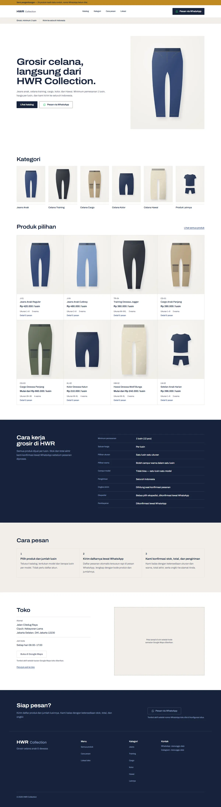
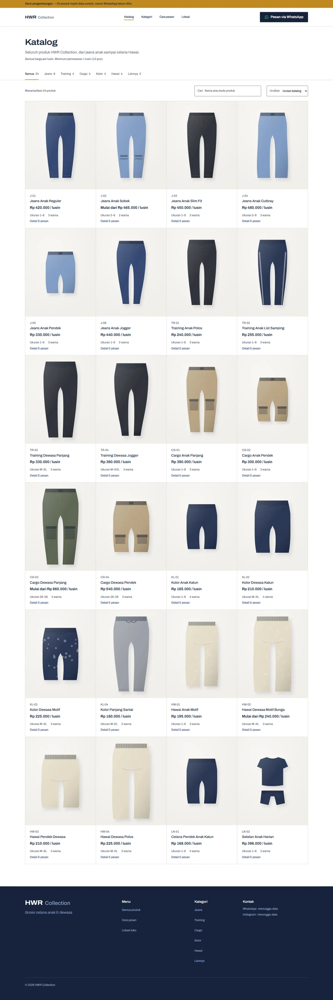
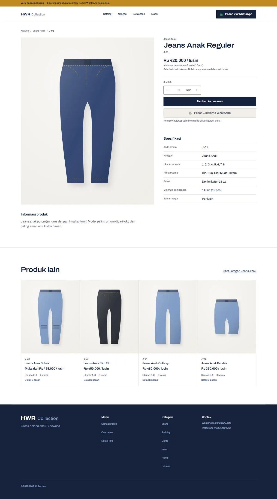
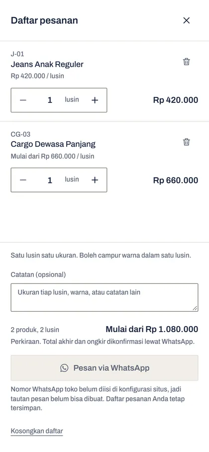
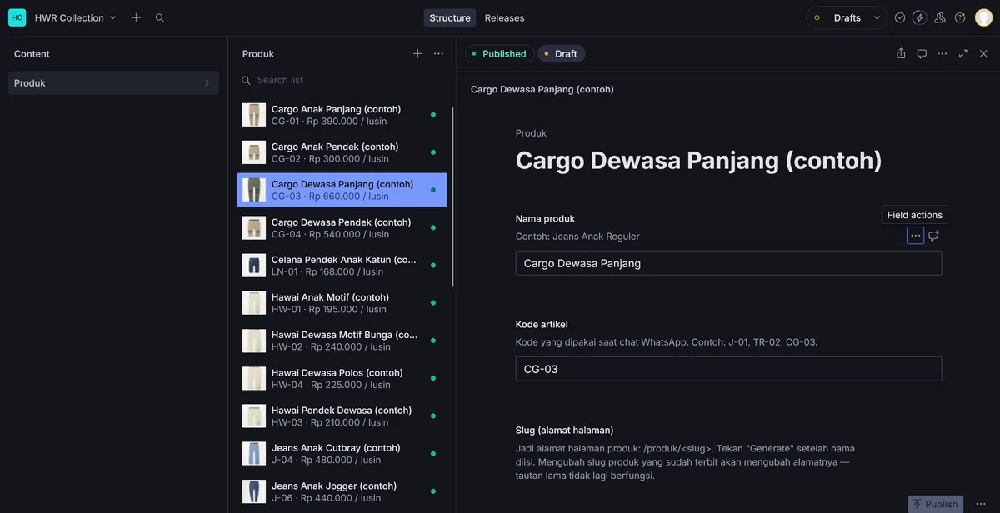

# HWR Collection

Website resmi HWR Collection, toko grosir celana anak dan dewasa. Isinya brand page, katalog produk, dan penyusun pesanan yang berakhir di pesan WhatsApp siap kirim. Tidak ada checkout, tidak ada akun, tidak ada pembayaran online.

Status: selesai dan terverifikasi sampai audit pra-peluncuran (Fase 1–7C). Yang menahan peluncuran tinggal data dari pemilik, bukan kodenya. Daftarnya ada di [docs/PELUNCURAN.md](docs/PELUNCURAN.md).

Produk dikelola dari Sanity Studio. Katalog sekarang berisi 24 produk contoh yang semuanya ditandai `dummy: true`. Alamat toko, jam buka, dan aturan grosir sudah data asli. Nomor WhatsApp dan domain masih placeholder, selengkapnya di [PLACEHOLDERS.md](PLACEHOLDERS.md). Selama nomor WhatsApp belum diisi, tombol pesan nonaktif dan tidak ada satu pun tautan `wa.me` yang dibuat.

Beberapa hal yang membentuk proyek ini:

**Nol KB JavaScript eksternal** di beranda, katalog, dan 404. Tombol daftar pesanan tidak merender apa pun selama daftarnya kosong, dan bagi pengunjung baru daftarnya selalu kosong. Jadi dibuat satu direktif hidrasi sendiri, `client:pesanan`, yang menahan island-nya sampai `localStorage` benar-benar berisi.

**Satu skema, dua sumber.** Produk boleh datang dari Sanity atau dari `products.json`. Skema Zod yang sama memvalidasi keduanya, jadi data dari CMS tidak lebih dipercaya daripada data dari file.

**Tidak ada informasi bisnis yang dikarang.** Apa pun yang belum diberikan pemilik tampil sebagai penanda "menunggu data", bukan diisi tebakan. Termasuk alamat, jam buka, dan nama ekspedisi.

**Verifikasi tidak menunggu kredensial.** Jalur Sanity diuji lawan stub API lokal, webhook rebuild lawan tanda tangan HMAC buatan, dan tautan `wa.me` lewat tambalan sementara yang dipulihkan setelah selesai. Jalur penting tidak boleh pertama kali dicoba justru saat data asli masuk.

## Tampilan

| Beranda | Katalog |
|---|---|
| [](docs/img/beranda.webp) | [](docs/img/katalog.webp) |

| Halaman produk | Daftar pesanan (mobile) |
|---|---|
| [](docs/img/produk.webp) |  |

Pita kuning di atas setiap halaman adalah penanda versi pengembangan. Ia menghitung sendiri berapa produk yang masih data contoh, dan hilang begitu tidak ada lagi yang ditandai `dummy`.

### Panel admin

[](docs/img/cms.webp)

Produk diurus dari Sanity Studio, bukan dari file. Daftar di tengah menampilkan kode artikel dan harga per lusin supaya produk bisa dikenali tanpa dibuka satu per satu. Label field dan teks bantuannya berbahasa Indonesia, karena yang memakainya pemilik toko, bukan developer. Tanda Published dan Draft di atas form itu bukan hiasan: situs hanya membaca yang sudah Published, jadi harga yang masih diisi setengah jalan tidak pernah sampai ke pengunjung.

Imbuhan "(contoh)" pada setiap nama produk datang dari tanda `dummy` di datanya, bukan diketik manual.

## Menjalankan

```bash
npm install
npx astro dev --background  # http://localhost:4321
```

Kelola dev server dengan `npx astro dev status`, `npx astro dev logs`, dan `npx astro dev stop`.

Produk ditarik dari dataset Sanity yang dibaca publik, jadi hasil clone langsung jalan. Tidak ada token yang perlu dibuat dan tidak ada `.env` yang perlu diisi untuk menjalankan situsnya.

> Dataset-nya memang dibuka untuk dibaca siapa saja, dan itu yang membuat build tidak perlu menyimpan token. Yang terbaca cuma 24 produk contoh. Menulis ke dataset tetap butuh login Sanity.

Untuk membuka panel adminnya sendiri:

```bash
cp sanity/.env.example sanity/.env   # isi SANITY_STUDIO_PROJECT_ID
npm run cms                          # http://localhost:3333
```

`npm run gen:photos` cuma dipakai untuk membuat ulang foto contoh di `src/assets/products/`, yaitu jalur cadangan `products.json`, bukan yang dipakai situs sekarang.

## Perintah

| Perintah | Kegunaan |
|---|---|
| `npm run dev` | Dev server (foreground) |
| `npm run validate` | Periksa data produk dan konfigurasi |
| `npm run build` | Build statis ke `dist/`, menjalankan `validate` lebih dulu |
| `npm run preview` | Lihat hasil build |
| `npm run gen:photos` | Regenerasi foto produk sementara dari `products.json` |
| `npm run shoot [rute...]` | Screenshot 390/768/1440 plus audit overflow, heading, alt, console |
| `npm run a11y [rute...]` | Uji keyboard, skip link, landmark, target sentuh, dan kontras hasil render |
| `npm run perf [rute...]` | LCP, CLS, byte per jenis, tugas panjang. Mobile ter-throttle dan desktop |
| `npm run journey` | Potret alur pesan: tambah produk, bar bawah, drawer |
| `npm run cms` | Jalankan Sanity Studio (panel admin) di localhost:3333 |
| `npm run cms:hook` | Penerima webhook rebuild, dengan verifikasi tanda tangan |
| `npm run cms:export` | Siapkan products.json jadi NDJSON dan foto untuk diimpor ke Sanity |
| `npm run test:cms` | Uji jalur Sanity ke Astro lawan stub API lokal |
| `npm run test:hook` | Uji verifikasi tanda tangan webhook |
| `npm run test:migrasi` | Gladi bersih migrasi: 24 produk menyeberang ke CMS lalu dibandingkan |
| `npm run test:katalog` | Uji filter, cari, urut, URL state, empty state, dan lapisan tanpa-JS |
| `npm run test:pesanan` | Uji 24 rute produk, 404, drawer, keyboard, penyimpanan |
| `npm run test:data` | Gladi bersih data asli: isi semua placeholder sementara, build, periksa, pulihkan |
| `npm run test:whatsapp` | Uji jalur wa.me dengan nomor uji sementara, lalu dipulihkan |
| `node scripts/inspect.mjs <mobile\|tablet\|desktop> [rute]` | Potongan seukuran layar untuk periksa detail |
| `npx astro check` | Type check |

Rute ditulis tanpa garis miring depan, misalnya `npm run shoot katalog katalog/jeans`, karena Git Bash di Windows menerjemahkan argumen berawalan `/` jadi path Windows.

Hasil screenshot masuk ke `.shots/` dan tidak ikut git.

## Struktur

```
src/
  config/site.ts          nomor WhatsApp, toko, merek, kebijakan grosir
  config/cms.ts           project Sanity, saklar sumber data produk
  content/products.json   24 produk dummy, cadangan sejak produk pindah ke Sanity
  content.config.ts       skema Zod untuk produk
  data/categories.ts      6 kategori
  lib/                    format harga, pesan WhatsApp, query produk, alamat toko, URL kanonik, jembatan CMS
  pages/robots.txt.ts     robots.txt, domainnya ikut site.url
  styles/tokens.css       satu-satunya tempat warna dan tipografi didefinisikan
  styles/global.css       font, base, sistem tipografi, utilitas layout
  components/             komponen dipakai lintas halaman
  components/home/        seksi khusus beranda
  components/catalog/     filter kategori dan tampilan katalog
  components/order/       island daftar pesanan (Preact + nanostores)
  components/product/     tabel spesifikasi produk
  assets/products/        foto produk contoh, jalur cadangan
scripts/                  generator foto, pemeriksa data, verifikasi visual, uji aksesibilitas
sanity/                   Sanity Studio, punya package.json sendiri
docs/                     keputusan, design system, wireframe, rencana, CMS, checklist peluncuran
```

## Mengganti data contoh dengan data asli

Prosedur lengkapnya, field per field, ada di **[docs/DATA.md](docs/DATA.md)**. Ringkasnya begini.

**Produk dan fotonya** sekarang diurus dari Sanity Studio, bukan dari file. Jalankan `npm run cms`, isi atau ubah produknya, unggah fotonya, lalu matikan tanda "Masih data contoh" per produk dan tekan Publish. Foto sebaiknya portrait 4:5 dengan sisi pendek minimal 1400px. Draft tidak pernah terbit ke situs.

`src/content/products.json` disimpan sebagai cadangan. Kalau `projectId` di `src/config/cms.ts` dikembalikan ke `PLACEHOLDER`, situs langsung membaca file itu lagi tanpa perubahan lain.

**Nomor WhatsApp** ada di `src/config/site.ts` pada `whatsappNumber`. Formatnya `6281234567890`, tanpa `+` dan tanpa `0` di depan. Ini juga satu-satunya tempat nomor ditulis di seluruh proyek; semua tombol membacanya dari sini. Selama masih placeholder, tidak ada tautan `wa.me` yang dibuat dan tombolnya menjelaskan kenapa.

**Informasi toko** ada di `site.ts` pada `store`: alamat, Google Maps, jam buka, telepon, email. Tidak ada satu pun yang dikarang. Yang kosong tampil sebagai penanda, dan tombol petunjuk arah baru dibuat setelah ada alamat sungguhan.

**Kebijakan grosir** ada di `site.ts` pada `wholesalePolicy`. Isinya pertanyaan yang muncul di hampir tiap chat reseller: boleh campur ukuran, boleh campur warna, ekspedisi apa. Yang masih `null` tampil sebagai "menunggu konfirmasi pemilik", bukan ditebak. Baris opsional seperti harga kodi, eceran, waktu proses, dan syarat reseller baru muncul setelah diisi.

**Logo** ditaruh di `public/`, lalu jalurnya diisi di `brand.logo`, contohnya `"/logo-hwr.svg"`. `Wordmark.astro` langsung memakainya di header dan footer dengan tinggi baris yang sama, jadi tata letak tidak bergeser.

**Favicon** mengganti `public/favicon.svg` dan `public/favicon.ico`. Jalurnya diatur di `brand.favicon`.

**Gambar Open Graph** berukuran 1200×630, ditaruh di `public/` dengan nama baru, lalu `brand.ogImage` diarahkan ke situ. Jangan menimpa `og-default.png`, karena file itu ditulis ulang tiap kali `npm run gen:photos` dijalankan.

**Warna brand** ada di `src/styles/tokens.css` dalam satu blok `@theme`. Tidak ada hex yang ditulis langsung di komponen.

**Domain** ada di `site.ts` pada `url`. Canonical, sitemap, robots.txt, dan Open Graph ikut berubah serentak.

Setelah mengganti apa pun, jalankan `npm run validate`.

## Dokumentasi

| Berkas | Isi |
|---|---|
| [docs/DECISIONS.md](docs/DECISIONS.md) | Kenapa Astro, kenapa skill ini, bagaimana konflik antar-skill diselesaikan |
| [docs/DESIGN-SYSTEM.md](docs/DESIGN-SYSTEM.md) | Warna beserta rasio kontrasnya, tipografi, spacing, grid, gambar, motion |
| [docs/WIREFRAMES.md](docs/WIREFRAMES.md) | Information architecture dan perubahan hasil verifikasi visual |
| [docs/DATA.md](docs/DATA.md) | Skema produk, arti tiap field, cara data asli menggantikan data contoh |
| [docs/CMS.md](docs/CMS.md) | Sanity Studio, webhook rebuild, migrasi data |
| [docs/PELUNCURAN.md](docs/PELUNCURAN.md) | Checklist sebelum situs boleh dipublikasikan |
| [docs/PLAN.md](docs/PLAN.md) | Fase implementasi |
| [CLAUDE.md](CLAUDE.md) | Aturan kerja di repo ini |

## Lisensi

Kode dalam repositori ini dirilis di bawah [MIT](LICENSE).

Yang tidak termasuk, dan tetap milik HWR Collection: nama dan identitas merek HWR Collection, teks serta informasi bisnis yang spesifik untuk toko itu, dan foto produk asli kalau suatu saat menggantikan foto contoh di sini. Foto yang ada sekarang dibuat oleh `scripts/gen-placeholder-photos.mjs` dan ikut lisensi yang sama dengan kodenya.

*The MIT license covers the code. The HWR Collection name, brand identity, and business information are not included and remain the property of HWR Collection.*
